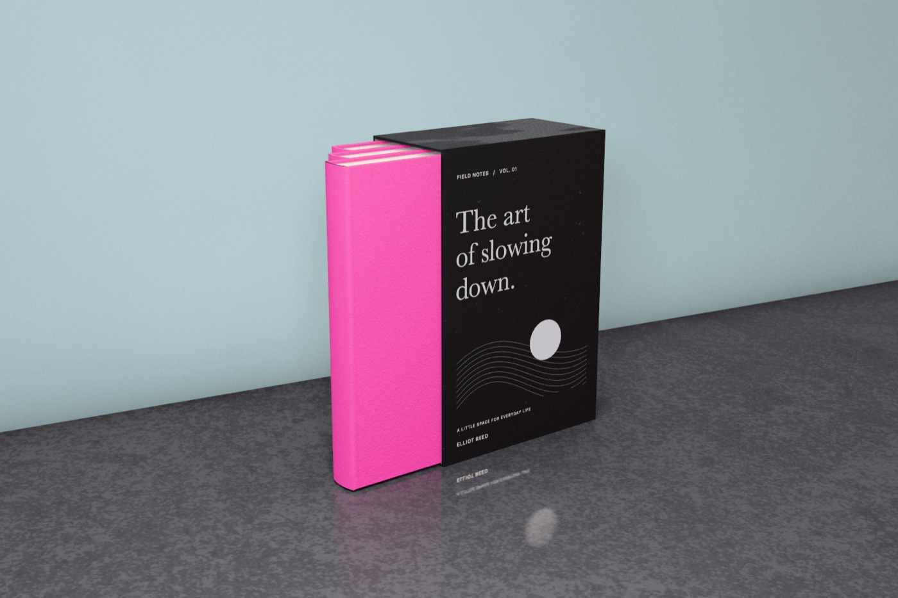
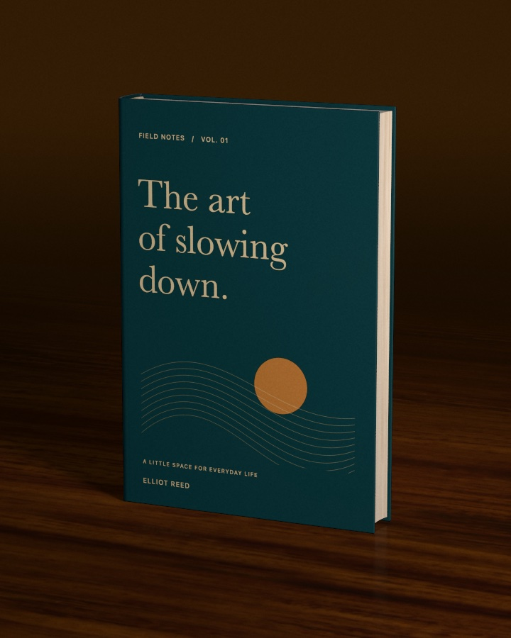
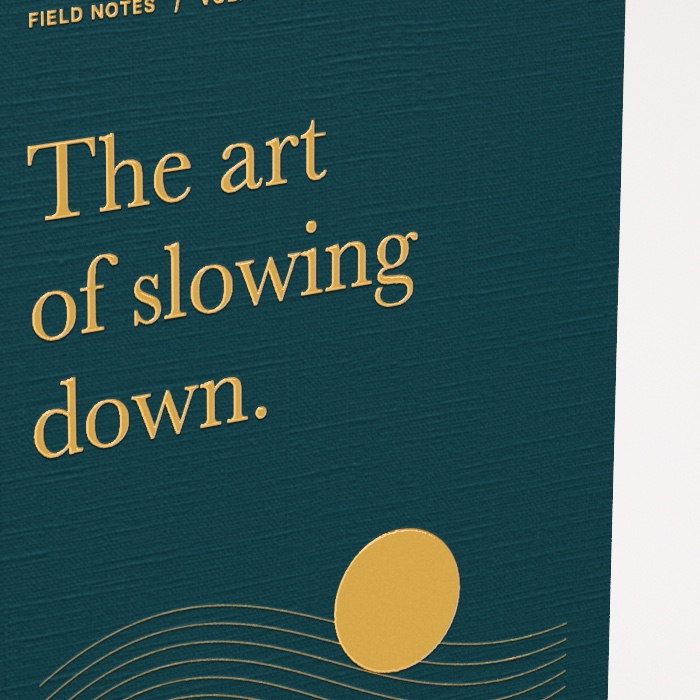

   
  <strong>Photographic book mockups on your Mac.</strong> 
  Hardbacks, paperbacks, open spreads, slipcases and box sets, rendered with real materials and real light.

<a href="../../releases/latest"><strong>Download the latest version</strong></a>

## What it does

- **Your cover, on a real book.** Drop in a full cover spread or separate front, spine and back. Mox splits it by the book's real proportions and sizes the book to fit.
- **Built like the real thing.** Sewn hardbacks with rounded spines, headbands and squares; glued paperbacks; open books with turning pages; slipcases that slide out, one book at a time or together.
- **Materials you can feel.** Linen and buckram cloth, uncoated paper, speckled board, soft-touch, gloss laminate — scanned from real samples.
- **Print finishes.** Gold, silver, rose gold, copper and holographic foil, spot UV, embossing and debossing.
- **Studio light.** Photographed lighting environments, spotlights, a wall-and-floor studio corner, and floors of oak, walnut, marble and terrazzo.
- **Ready to post.** Export stills up to 8000 px with a Photoshop clipping path, sized for Instagram, TikTok, LinkedIn, X and more, or a turntable video of the book turning.

  
  
  

## Install

1. Download the `.dmg` from the [latest release](../../releases/latest), open it, and drag **Mox** onto the Applications folder.
2. The first time you open it, macOS stops it because it isn't notarised by Apple yet. Click **Done**, then open **System Settings → Privacy & Security** and choose **Open Anyway** next to Mox.

Mox needs a Mac with Apple silicon (M1 or later) and macOS 14 Sonoma or newer. It checks this page for updates when it opens and installs them for you. Your artwork and projects never leave your Mac.

## Feedback

Found a bug or have an idea? Use the ladybug button in Mox's toolbar to send a note with a picture of what you're seeing.
